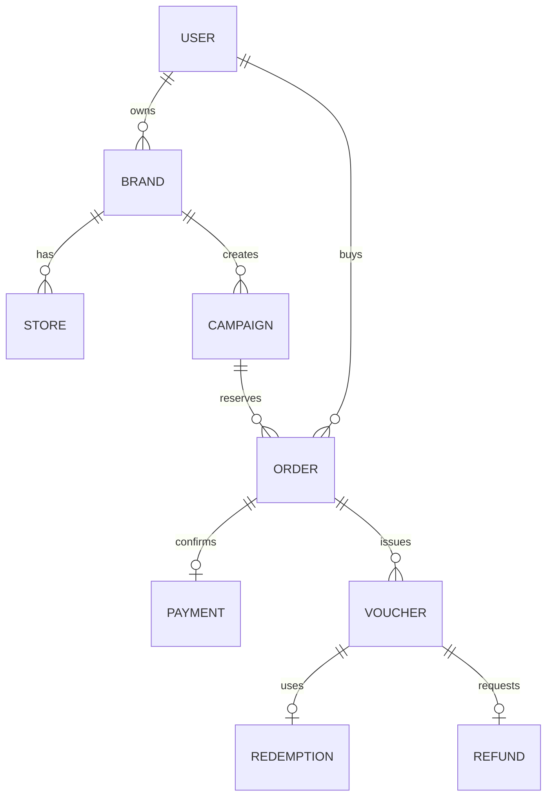

# MongoDB — voucher_platform

Dùng MongoDB 8, Mongoose 9, replica set `rs0`. Local tại `127.0.0.1:27018`; lưu WiredTiger trong `backend/.data/mongo`. Không lưu trong RAM như pg-mem của backend cũ.

| Collection mặc định Mongoose | Nội dung | Index chính |
|---|---|---|
| users | Email, vai trò, mật khẩu hash, storeIds | email UNIQUE |
| sessions | Phiên, refresh HMAC, chi nhánh đang làm | expiresAt TTL |
| otps | HMAC mã email, số lần thử, đã dùng | email UNIQUE; expiresAt TTL có thời gian đệm |
| brands | Chủ sở hữu và trạng thái duyệt | ownerId |
| stores | Chi nhánh, địa chỉ, GeoJSON | location 2dsphere; brandId/active |
| campaigns | Ba loại voucher, giá, lịch, tồn kho, storeIds | status/thời gian; brandId |
| quotas | Tổng số đã mua/giữ của một khách trên chiến dịch | userId+campaignId UNIQUE |
| orders | Một chiến dịch mỗi đơn, snapshot quyền lợi | customerId+idempotencyKey UNIQUE; status/expiresAt |
| payments | Xác nhận demo thành công | orderId UNIQUE; eventId UNIQUE |
| vouchers | Voucher được cấp sau thanh toán | orderId+itemIndex UNIQUE; customerId/status |
| redeemtokens | QR/OTP HMAC hiện hành | voucherId, tokenHash, otpHash UNIQUE; expiresAt TTL |
| redemptions | Lịch sử sử dụng, hóa đơn, giảm giá | voucherId UNIQUE |
| refunds | Yêu cầu hoàn, số tiền, quyết định | voucherId UNIQUE |
| audits | Người thao tác và hành động | _id mặc định |

Quan hệ dùng ObjectId; JSON trả `id` dạng chuỗi và bỏ `_id`, `__v`, các trường hash. Khi populate thương hiệu, `brandId` trả object thương hiệu; client mới cần đọc theo hợp đồng này. Tiền lưu number nguyên an toàn, tối đa theo DTO; không dùng số thực cho VND.

Các transaction quan trọng: reserve stock+quota+order; payment+vouchers+stock+quota; cancel+release; token+voucher; redeem+log; refund+voucher+stock/quota. Không chạy thao tác song song trên cùng transaction/session. Index được khởi tạo trước khi nhận request.

TTL chỉ dọn phiên và token. Không dùng TTL xóa đơn hoặc voucher: lịch bảo trì chuyển trạng thái để giữ lịch sử và trả tồn kho. TTL có thể trễ; mọi kiểm tra hiệu lực vẫn so sánh expiresAt trong truy vấn.

MongoDB Atlas replica set dùng được qua MONGODB_URI. Khi dùng Docker với Compose trong repo, dữ liệu ở named volume khác với `.data/mongo`; chuyển cách chạy không tự chuyển dữ liệu. Cấu hình local không dành cho public server.
